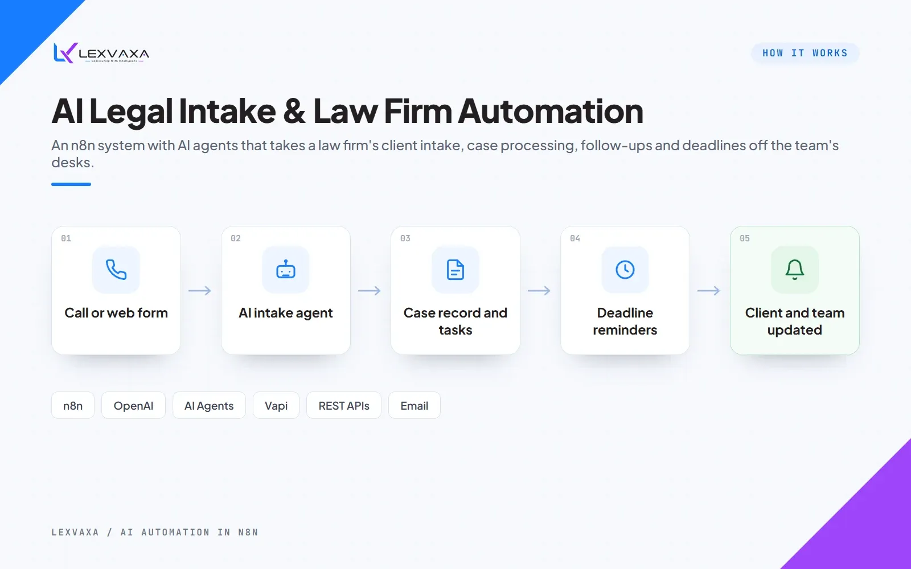
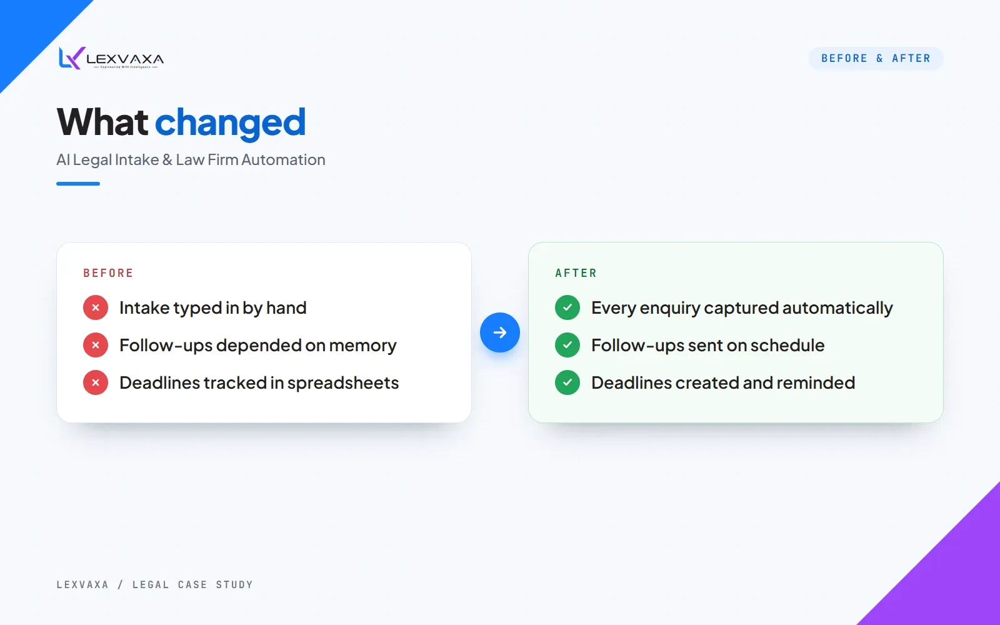

# AI Legal Intake & Law Firm Automation

**An n8n system with AI agents that takes a law firm's client intake, case processing, follow-ups and deadlines off the team's desks.**

       

## Overview

A legal team handled client intake, case information, follow-ups and deadlines by hand, so leads and tasks slipped through. We built one production workflow in n8n, triggered by calls and web enquiries, where AI agents read each new matter, create the right tasks and records, send client updates and alert the team across their channels. The firm now runs intake, tasks and deadlines through one automated system with no manual data entry.

## The challenge

Client intake, case details, follow-ups and deadlines were all handled manually. New enquiries waited, information was re-typed between tools, and tasks were easy to miss when the team was busy.

## The solution

A production n8n workflow with AI agents: smart client intake from calls and forms, AI case processing and task creation, automated client follow-ups and updates, deadline and document handling, and team notifications across channels.

## How it works

1. **A new enquiry arrives.** A call through the voice agent or a web form starts the workflow. The caller's details and the facts of the matter are captured once.
2. **AI reads and classifies the case.** AI agents extract the key facts, classify the matter type and check what information is still missing.
3. **Tasks, records and deadlines created.** The right tasks, case records and deadline reminders are created automatically, with no re-typing.
4. **Client and team updated.** Follow-up messages go to the client and the team is notified on the channels they already use.

## Key features

- Smart legal client intake from calls and web forms
- AI case processing and task creation
- Automated client follow-ups and status updates
- Deadline and document handling
- Team notifications across channels

## Results

- Intake, tasks and deadlines run through one automated system
- No manual data entry between intake and case records

## Tech stack

n8n · OpenAI · AI Agents · Vapi · REST APIs · Email · Google Sheets

## Screens

## Privacy

Client names and records are confidential. Every screen in this repository uses sample data, and source code that belongs to the client is not published.

## Links

- Case study on Lexvaxa: https://lexvaxa.com/work/ai-legal-intake-automation
- Built by **Ch Muhammad Samiullah** ([GitHub](https://github.com/samiullah156-creator)) at [Lexvaxa](https://lexvaxa.com)
